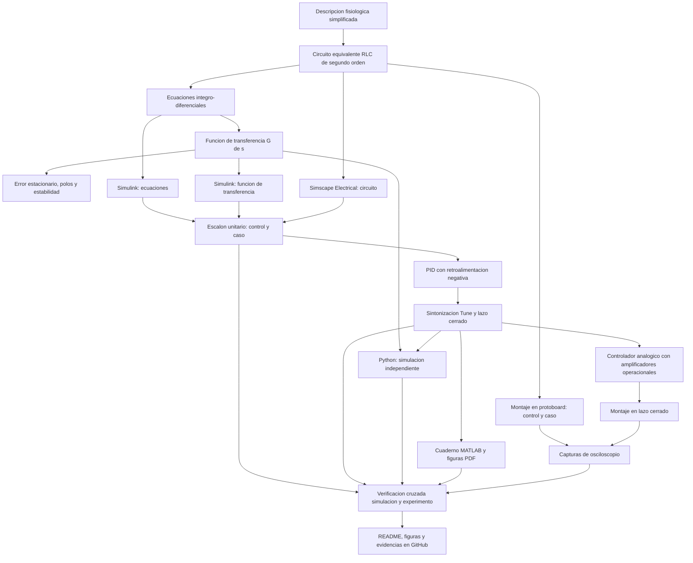

[](https://matlab.mathworks.com/open/github/v1?repo=l23212177-ship-it/MSFP4)

# Modelado y control del sistema endocrino (MSFP4)

Repositorio académico de la asignatura **Modelado de Sistemas Fisiológicos**, correspondiente al programa de **Ingeniería Biomédica** del Tecnológico Nacional de México / Instituto Tecnológico de Tijuana. Esta práctica integra analogías eléctricas, ecuaciones integro-diferenciales, funciones de transferencia, análisis de estabilidad, diseño de un controlador PID, simulación computacional y verificación experimental en el Laboratorio de Electrónica.

El caso de estudio interpreta una descripción simplificada de los procesos de **secreción, transporte, almacenamiento y respuesta hormonal** y la representa con un **circuito eléctrico equivalente de segundo orden** (R₁, C, L y R₂). Se compara una condición de referencia (**control**) con una condición alterada (**caso**), y se diseña un controlador PID que reduce la diferencia entre la respuesta hormonal del caso y la del control. Los resultados se contrastan mediante modelado analítico, MATLAB/Simulink, Simscape Electrical, Python y montajes en protoboard.

**Docente:** Dr. Paul Antonio Valle Trujillo  
**Correo:** paul.valle@tectijuana.edu.mx  
**Departamento:** Ingeniería Eléctrica y Electrónica  
**Institución:** Tecnológico Nacional de México / Instituto Tecnológico de Tijuana  
**Asignatura:** Modelado de Sistemas Fisiológicos  
**Programa:** Ingeniería Biomédica  
**Estudiante:** Gael Sebastian Andrade Arellano · Número de control · correo@tijuana.tecnm.mx

**Repositorio de la asignatura:** https://github.com/DrPaulValle/MSF-IBF1020  
**Sede:** Blvd. Alberto Limón Padilla s/n, Tijuana, C. P. 22454, B. C., México.

---

<a id="contenido"></a>
## Contenido

1. [Resumen](#resumen)
2. [Competencia y objetivos](#objetivos)
3. [Relación con el temario](#temario)
4. [Interpretación fisiológica y analogía eléctrica](#analogia)
5. [Formulación matemática](#modelo)
6. [Análisis temporal y de estabilidad](#analisis)
7. [Señales de entrada y condiciones de simulación](#senales)
8. [Implementación en MATLAB, Simulink y Simscape](#matlab)
9. [Control en lazo cerrado y sintonización PID](#pid)
10. [Controlador analógico con amplificadores operacionales](#analogico)
11. [Reproducción en Python](#python)
12. [Implementación experimental](#experimental)
13. [Resultados y verificación cruzada](#resultados)
14. [Flujo de trabajo](#flujo)
15. [Actividades del estudiante](#actividades)
16. [Estructura del repositorio](#estructura)
17. [Requisitos](#requisitos)
18. [Reproducibilidad y entregables](#reproducibilidad)
19. [Referencias](#referencias)

---

<a id="resumen"></a>
## Resumen

La práctica tiene como propósito **interpretar, modelar, simular, controlar y verificar experimentalmente** un sistema fisiológico simplificado a partir de su analogía con un circuito eléctrico. Un estímulo fisiológico se representa con la fuente $V_e(t)$; el transporte hormonal, con la resistencia $R_1$; la acumulación temporal de la señal, con el capacitor $C$; y la respuesta retardada del tejido diana, con la rama en serie formada por el inductor $L$ y la resistencia $R_2$. La salida $V_s(t)$ representa el nivel efectivo y normalizado de la señal hormonal. Debido a los dos elementos independientes de almacenamiento de energía ($C$ y $L$), el circuito es un sistema dinámico de **segundo orden**.

Se obtienen las ecuaciones integro-diferenciales y la función de transferencia $G(s)=V_s(s)/V_e(s)$ del control y del caso, el error en estado estacionario, los polos y la estabilidad. En el caso se modifican simultáneamente $C$ (de $1\,\mu\mathrm{F}$ a $1000\,\mu\mathrm{F}$) y $R_2$ (de $100\,\mathrm{k}\Omega$ a $1\,\mathrm{k}\Omega$). Ambos modelos se implementan en MATLAB/Simulink (ecuaciones, función de transferencia y circuito en Simscape Electrical) y se comparan ante un escalón unitario en $t\in[0,10]\,\mathrm{s}$. La respuesta del control se usa como referencia para el caso, y un **controlador PID** sintonizado con la herramienta *Tune* reduce el error $e(t)=V_{s,\mathrm{control}}(t)-V_{s,\mathrm{caso}}(t)$. Con las ganancias obtenidas se calculan los componentes de un controlador analógico con amplificadores operacionales, y los resultados se reproducen con un cuaderno de MATLAB, con Python y con mediciones de osciloscopio.

El modelo es **fenomenológico y con fines académicos**: no representa un eje hormonal específico ni establece una equivalencia directa entre los valores de los componentes eléctricos y parámetros fisiológicos medidos experimentalmente.

**Palabras clave:** sistema endocrino; secreción hormonal; analogía eléctrica; circuito RLC de segundo orden; ecuaciones integro-diferenciales; función de transferencia; estabilidad; controlador PID; amplificadores operacionales; MATLAB; Simulink; Simscape Electrical; Python; Laboratorio de Electrónica.

[Volver al contenido](#contenido)

---

<a id="objetivos"></a>
## Competencia y objetivos

### Competencia a desarrollar

Modelizar sistemas fisiológicos mediante analogías eléctricas, ecuaciones diferenciales y funciones de transferencia para analizar su comportamiento dinámico, y diseñar estrategias de control mediante técnicas de control clásico. En esta práctica el estudiante interpreta una descripción simplificada de los procesos de secreción, transporte, almacenamiento y respuesta hormonal para proponer un circuito eléctrico equivalente de segundo orden; compara una condición de referencia (control) con una condición alterada (caso), diseña un controlador PID y contrasta los resultados mediante modelado analítico, simulación computacional y experimentación en el Laboratorio de Electrónica.

### Objetivo general

Modelar y controlar el sistema endocrino simplificado mediante su analogía eléctrica de segundo orden, comparando las respuestas del control, del caso y del caso con controlador ante un escalón unitario, y verificando los resultados con MATLAB, Simulink, Simscape Electrical, Python y mediciones experimentales.

### Objetivos específicos

- Interpretar la descripción fisiológica y proponer la topología del circuito equivalente.
- Identificar $V_e(t)$, $V_s(t)$, $R_1$, $C$, $L$, $R_2$, $F_e(t)$ y $F_s(t)$, los nodos principales y la referencia eléctrica.
- Aplicar las leyes de Kirchhoff para formular las ecuaciones integro-diferenciales del sistema.
- Obtener las funciones de transferencia $G_{\mathrm{control}}(s)$ y $G_{\mathrm{caso}}(s)$ y relacionar su orden con $C$ y $L$.
- Calcular el error en estado estacionario y los polos, y determinar la estabilidad de ambas condiciones.
- Analizar el efecto de modificar $C$ y $R_2$ sobre la posición de los polos y la dinámica.
- Simular el modelo con ecuaciones, función de transferencia y componentes de Simscape Electrical.
- Comparar el control y el caso ante un escalón unitario en $t\in[0,10]\,\mathrm{s}$, en lazo abierto y en lazo cerrado.
- Sintonizar un controlador PID y calcular los componentes de su implementación analógica con amplificadores operacionales.
- Reproducir las respuestas con un cuaderno de MATLAB y con Python.
- Construir y medir los circuitos en el Laboratorio de Electrónica y contrastarlos con las simulaciones.
- Documentar el desarrollo en un repositorio de GitHub.

[Volver al contenido](#contenido)

---

<a id="temario"></a>
## Relación con el temario

El instructivo de la práctica no enumera unidades temáticas; la relación siguiente se establece por contenido y es análoga a la de las prácticas previas de la asignatura **Modelado de Sistemas Fisiológicos (IBF-1020)**:

| Área | Contenidos aplicados |
|---|---|
| Sistemas de control retroalimentados | Diagrama de bloques con retroalimentación negativa, señal de error, respuesta al escalón, estabilidad y error en estado estacionario |
| Modelado matemático | Analogía eléctrica, leyes de Kirchhoff, ecuaciones integro-diferenciales, función de transferencia y análisis de polos |
| Controladores | Diseño del PID, sintonización con *Tune* e implementación analógica con amplificadores operacionales |
| Electrónica y experimentación | Circuitos RLC, montaje en protoboard, generador de funciones y osciloscopio |

El enfoque combina **Ingeniería de Control, Electrónica Analógica, Ciencias de la Computación y Fisiología**.

[Volver al contenido](#contenido)

---

<a id="analogia"></a>
## Interpretación fisiológica y analogía eléctrica

### Hipótesis del modelo

1. Un estímulo fisiológico (neural, metabólico u homeostático) inicia la secreción hormonal: fuente de voltaje $V_e(t)$.
2. La hormona se transporta desde la glándula hasta el compartimento donde actúa, con posibles retrasos, pérdidas o mecanismos de eliminación: resistencia $R_1$.
3. Parte de la señal se acumula temporalmente antes de utilizarse o eliminarse: capacitancia $C$.
4. La respuesta del tejido diana no es instantánea; la oposición a los cambios y el retardo se representan con una rama en serie formada por $L$ y $R_2$.
5. El flujo de secreción y transporte se representa con $F_e(t)$ y el de utilización o respuesta del órgano diana con $F_s(t)$.
6. La salida $V_s(t)$ es el nivel efectivo y normalizado de la señal hormonal disponible en el compartimento de interés.

### Correspondencias de la analogía

| Variable o proceso fisiológico | Representación eléctrica | Interpretación dentro del modelo |
|---|---|---|
| Estímulo para la secreción hormonal | $V_e(t)$ | Señal de entrada que activa la respuesta del sistema |
| Flujo de secreción y transporte hormonal | $F_e(t)$ | Corriente que transfiere la señal desde la fuente hacia el compartimento de respuesta |
| Pérdidas y oposición durante el transporte | $R_1$ | Procesos que reducen o retardan la transmisión de la señal |
| Acumulación temporal de hormona | $C$ | Capacidad de almacenar temporalmente la señal antes de su utilización o eliminación |
| Retardo o inercia de la respuesta del tejido diana | $L$ | Resistencia dinámica a cambios rápidos en la respuesta hormonal |
| Utilización, disipación o eliminación de la señal | $R_2$ | Oposición asociada con la utilización o desaparición de la señal |
| Flujo asociado con la respuesta del tejido diana | $F_s(t)$ | Corriente de la rama que representa la respuesta del órgano diana |
| Nivel hormonal efectivo | $V_s(t)$ | Variable de salida normalizada |

### Diagrama biológico


*Figura. Diagrama biológico elaborado en BioRender: relaciona la secreción hormonal de la glándula endocrina, su transporte, el almacenamiento en la tiroides, la resistencia dinámica asociada al páncreas, la degradación hormonal y la señal que llega al tejido receptor (receptores de los huesos) con los elementos del circuito eléctrico equivalente.*

| Elemento del diagrama | Elemento del circuito | Interpretación |
|---|---|---|
| Glándula endocrina: secreción de hormonas | $V_e(t)$ | Estímulo que inicia la secreción hormonal |
| Flecha de la glándula a la tiroides | $F_e(t)$ | Flujo de secreción y transporte hormonal |
| Pérdidas de transporte | $R_1$ (rotulada "R" en el diagrama) | Oposición y pérdidas durante el transporte |
| Tiroides: almacenamiento de T3/T4 | $C$ | Acumulación temporal de la señal hormonal |
| Páncreas: resistencia dinámica a cambios rápidos | $L$ | Retardo o inercia de la respuesta |
| Receptores de los huesos: oposición asociada al consumo o degradación hormonal | $R_2$ | Utilización, disipación o eliminación de la señal |
| Salida normalizada de la señal hacia el tejido receptor | $V_s(t)$ | Nivel hormonal efectivo |
| Respuesta metabólica | Respuesta del órgano diana | Efecto fisiológico de la señal |

El diagrama es una representación didáctica: las estructuras ilustradas se asocian de manera simplificada con los elementos del modelo y no implican una equivalencia fisiológica directa.

### Circuito eléctrico equivalente

La topología se deduce de la descripción: una rama principal formada por $V_e(t)$ y $R_1$; en el nodo posterior a $R_1$ (nodo de salida $V_s$), un capacitor $C$ a la referencia, en paralelo con la rama en serie $L$–$R_2$ a la referencia.

```text
          R1            Vs(t)
 Ve(t) o--/\/\/--------+---------+
   (+)   --Fe-->       |         |
                       |         |
                      ===        L
                       |         |
                       |  C      R2
                       |         |   Fs (hacia abajo)
 GND   o---------------+---------+
```

La terminal negativa de $V_e(t)$ se conecta a la referencia (GND). Lista de conexiones (*netlist*):

| Elemento | Nodo A | Nodo B |
|---|---|---|
| $V_e(t)$ | N1 | GND |
| $R_1$ | N1 | $V_s$ |
| $C$ | $V_s$ | GND |
| $L$ | $V_s$ | N2 |
| $R_2$ | N2 | GND |

El nodo $V_s$ es la unión entre $R_1$, $C$ y $L$. El flujo $F_e(t)$ es la corriente en $R_1$ y $F_s(t)$ es la corriente en la rama $L$–$R_2$.

<!-- Para incluir el diagrama propio (item 1 de la práctica), sube la imagen del circuito al repositorio y quita los comentarios de la línea siguiente:

-->

### Valores de los componentes

| Componente | Control | Caso |
|---|---:|---:|
| $R_1$ | $1\,\mathrm{k}\Omega$ | $1\,\mathrm{k}\Omega$ |
| $L$ | $100\,\mathrm{mH}$ | $100\,\mathrm{mH}$ |
| $C$ | $1\,\mu\mathrm{F}$ | $1000\,\mu\mathrm{F}$ |
| $R_2$ | $100\,\mathrm{k}\Omega$ | $1\,\mathrm{k}\Omega$ |

La modificación simultánea de $C$ y $R_2$ produce una dinámica distinta entre control y caso y permite analizar el efecto de las propiedades de almacenamiento y disipación sobre la respuesta temporal.

> **Alcance de la analogía:** las correspondencias son una analogía fenomenológica con fines académicos. Las unidades y los valores de los componentes eléctricos no representan directamente magnitudes fisiológicas del sistema endocrino.

[Volver al contenido](#contenido)

---

<a id="modelo"></a>
## Formulación matemática

### 1. Ecuaciones integro-diferenciales

Con $V_s$ el voltaje del capacitor y $F_s$ la corriente del inductor (los dos elementos independientes de almacenamiento de energía), las leyes de Kirchhoff dan:

$$
V_e(t)=R_1F_e(t)+V_s(t)\qquad\text{(malla de entrada)},
$$

$$
F_e(t)=C\frac{dV_s(t)}{dt}+F_s(t)\qquad\text{(nodo }V_s\text{)},
$$

$$
V_s(t)=L\frac{dF_s(t)}{dt}+R_2F_s(t)\qquad\text{(rama }L\text{–}R_2\text{)}.
$$

En forma integral:

$$
V_s(t)=\frac{1}{C}\int_0^t\left[F_e(\tau)-F_s(\tau)\right]d\tau+V_s(0),\qquad
F_s(t)=\frac{1}{L}\int_0^t\left[V_s(\tau)-R_2F_s(\tau)\right]d\tau+F_s(0),
$$

con $F_e(t)=\dfrac{V_e(t)-V_s(t)}{R_1}$.

### 2. Función de transferencia

Con condiciones iniciales nulas:

$$
V_e=R_1F_e+V_s,\qquad F_e=CsV_s+F_s,\qquad F_s=\frac{V_s}{Ls+R_2}.
$$

Sustituyendo y despejando se obtiene

$$
\boxed{G(s)=\frac{V_s(s)}{V_e(s)}=\frac{Ls+R_2}{R_1LC\,s^2+\left(R_1R_2C+L\right)s+R_1+R_2}.}
$$

El denominador es de **segundo grado** porque hay dos elementos independientes de almacenamiento ($C$ y $L$). La frecuencia natural y el amortiguamiento son

$$
\omega_n=\sqrt{\frac{R_1+R_2}{R_1LC}},\qquad
\zeta=\frac{R_1R_2C+L}{2\sqrt{R_1LC\left(R_1+R_2\right)}}.
$$

Sustituyendo los valores de cada condición:

$$
G_{\mathrm{control}}(s)=\frac{0.1\,s+10^{5}}{10^{-4}s^2+100.1\,s+1.01\times10^{5}}
=\frac{10^{3}s+10^{9}}{s^2+1.001\times10^{6}s+1.01\times10^{9}},
$$

$$
G_{\mathrm{caso}}(s)=\frac{0.1\,s+10^{3}}{0.1\,s^2+1000.1\,s+2000}
=\frac{s+10^{4}}{s^2+10001\,s+2\times10^{4}}.
$$

### 3. Representación en variables de estado

Con $x=\begin{bmatrix}V_s & F_s\end{bmatrix}^{T}$, entrada $V_e$ y salida $V_s$:

$$
\dot x=\begin{bmatrix}-\dfrac{1}{R_1C} & -\dfrac{1}{C}\\[2mm] \dfrac{1}{L} & -\dfrac{R_2}{L}\end{bmatrix}x+\begin{bmatrix}\dfrac{1}{R_1C}\\[2mm]0\end{bmatrix}V_e,\qquad
V_s=\begin{bmatrix}1&0\end{bmatrix}x.
$$

[Volver al contenido](#contenido)

---

<a id="analisis"></a>
## Análisis temporal y de estabilidad

### 1. Error en estado estacionario

Para el escalón unitario $V_e(t)=u(t)$ ($V_e(s)=1/s$) y sistemas estables, el valor final es $G(0)$:

$$
V_s(\infty)=G(0)=\frac{R_2}{R_1+R_2}.
$$

| Condición | $V_s(\infty)$ | $e_{ss}=1-V_s(\infty)$ respecto de la entrada |
|---|---:|---:|
| Control | $\dfrac{100}{101}\approx0.9901\,\mathrm{V}$ | $\dfrac{1}{101}\approx0.0099$ |
| Caso | $\dfrac{1}{2}=0.5\,\mathrm{V}$ | $\dfrac{1}{2}=0.5$ |

A diferencia de lo que ocurre si solo se modificara la dinámica, aquí **los valores finales difieren**: la diferencia en estado estacionario entre control y caso es

$$
V_{s,\mathrm{control}}(\infty)-V_{s,\mathrm{caso}}(\infty)=\frac{100}{101}-\frac{1}{2}=\frac{99}{202}\approx0.4901\,\mathrm{V}.
$$

El controlador debe reducir tanto esta diferencia estacionaria como la diferencia en la respuesta transitoria. En estado estacionario, además, $F_e(\infty)=F_s(\infty)=V_e/(R_1+R_2)$: $\approx9.9\,\mu\mathrm{A}$ en el control y $0.5\,\mathrm{mA}$ en el caso.

### 2. Polos, ceros y estabilidad

| Condición | Polos (rad/s) | Cero (rad/s) | $\omega_n$ (rad/s) | $\zeta$ |
|---|---|---:|---:|---:|
| Control | $-1010.01$ y $-999\,989.99$ | $-10^{6}$ | $\approx31\,780$ | $\approx15.7$ |
| Caso | $-2.0002$ y $-9999.00$ | $-10^{4}$ | $\approx141.4$ | $\approx35.4$ |

Los polos de ambas condiciones son **reales, distintos y negativos**: los dos sistemas son **estables** y **sobreamortiguados** ($\zeta\gg1$), por lo que no presentan oscilaciones ni sobreimpulso. La modificación de $C$ y $R_2$ desplaza el polo dominante de $-1010\,\mathrm{rad/s}$ (control) a $-2\,\mathrm{rad/s}$ (caso): la respuesta del caso es unas 500 veces más lenta.

En ambos casos el polo rápido queda casi cancelado por el cero (por ejemplo, $-9999$ frente a $-10^4$ en el caso), por lo que cada respuesta se comporta, de manera aproximada, como un sistema de primer orden con el polo dominante:

$$
G_{\mathrm{control}}(s)\approx\frac{0.9901}{1+s/1010},\qquad
G_{\mathrm{caso}}(s)\approx\frac{0.5}{1+s/2.0002}.
$$

Constantes de tiempo aproximadas: $\tau_{\mathrm{control}}\approx0.99\,\mathrm{ms}$ y $\tau_{\mathrm{caso}}\approx0.5\,\mathrm{s}$; tiempos de establecimiento ($\approx4\tau$) de $\approx4\,\mathrm{ms}$ y $\approx2\,\mathrm{s}$.

### 3. Valores de referencia de la respuesta al escalón

Valores calculados a partir de $G(s)$, útiles para verificar las simulaciones y las mediciones:

| $t$ | $V_{s,\mathrm{control}}(t)$ | $V_{s,\mathrm{caso}}(t)$ |
|---:|---:|---:|
| $1\,\mathrm{ms}$ | $0.6295$ | $0.0010$ |
| $10\,\mathrm{ms}$ | $0.9901$ | $0.0099$ |
| $0.1\,\mathrm{s}$ | $0.9901$ | $0.0906$ |
| $0.5\,\mathrm{s}$ | $0.9901$ | $0.3161$ |
| $1\,\mathrm{s}$ | $0.9901$ | $0.4323$ |
| $2\,\mathrm{s}$ | $0.9901$ | $0.4908$ |
| $5\,\mathrm{s}$ | $0.9901$ | $0.49998$ |

Ambas respuestas son monótonas crecientes. En una ventana de $10\,\mathrm{s}$ el control alcanza su valor final en milisegundos, por lo que conviene incluir una vista ampliada del inicio de la respuesta.

### 4. Bosquejo cualitativo previo

Antes de simular, elaborar un **bosquejo** de la respuesta al escalón del control y del caso a partir de los polos, la estabilidad y el valor final, y compararlo con las simulaciones.

#### Ejemplo mínimo de verificación en MATLAB

```matlab
R1 = 1e3;  L = 100e-3;

% Control
C = 1e-6;   R2 = 100e3;
G_control = tf([L, R2], [R1*L*C, R1*R2*C + L, R1 + R2]);

% Caso
C = 1000e-6; R2 = 1e3;
G_caso = tf([L, R2], [R1*L*C, R1*R2*C + L, R1 + R2]);

pole(G_control), pole(G_caso)
dcgain(G_control), dcgain(G_caso)    % 100/101 y 1/2
step(G_control, G_caso, 10)
```

Este código es ilustrativo; no sustituye los archivos y procedimientos solicitados en la práctica.

[Volver al contenido](#contenido)

---

<a id="senales"></a>
## Señales de entrada y condiciones de simulación

La entrada es un **escalón unitario**, $V_e(t)=u(t)$, que representa un estímulo sostenido aplicado al sistema. El intervalo de simulación es $0\le t\le10\,\mathrm{s}$ y las condiciones iniciales se consideran nulas. El instructivo no especifica el solver ni el paso máximo; deben **documentarse** los empleados en Simulink y en Python.

| Análisis | Entrada | Intervalo | Variables comparadas |
|---|---|---|---|
| Lazo abierto | Escalón unitario | $0\le t\le10\,\mathrm{s}$ | $V_{s,\mathrm{control}}(t)$ y $V_{s,\mathrm{caso}}(t)$ |
| Lazo cerrado | Escalón unitario | $0\le t\le10\,\mathrm{s}$ | $V_{s,\mathrm{control}}(t)$, $V_{s,\mathrm{caso}}(t)$ y $V_{s,\mathrm{PID}}(t)$ |

[Volver al contenido](#contenido)

---

<a id="matlab"></a>
## Implementación en MATLAB, Simulink y Simscape

Para las condiciones **control** y **caso** se construyen tres representaciones equivalentes:

| Implementación | Descripción | Aspecto por verificar |
|---|---|---|
| Ecuaciones integro-diferenciales, Simulink | Bloques que implementan las ecuaciones de Kirchhoff (integradores para $V_s$ y $F_s$) | Consistencia con las leyes de Kirchhoff |
| Función de transferencia, Simulink | Bloque con $G_{\mathrm{control}}(s)$ y $G_{\mathrm{caso}}(s)$ | Respuesta entrada–salida de segundo orden |
| Circuito equivalente, Simscape Electrical | Fuente $V_e$, $R_1$, $C$, $L$ y $R_2$ con la topología propuesta | Concordancia con las representaciones matemáticas |

Debe verificarse que las tres representaciones produzcan **respuestas consistentes para las mismas condiciones iniciales y la misma entrada**.

### Ejecución desde el cuaderno MATLAB

El cuaderno computacional ejecuta el modelo de Simulink y extrae las respuestas del **control**, del **caso** y del **sistema controlado**. Además, se desarrolla una función que (a) represente gráficamente las respuestas, (b) identifique las variables y sus unidades, (c) compare lazo abierto y lazo cerrado y (d) guarde las figuras en formato PDF.

[Volver al contenido](#contenido)

---

<a id="pid"></a>
## Control en lazo cerrado y sintonización PID

### 1. Esquema de control (Figura 5.5 del instructivo)

La respuesta del control es la referencia del caso. El modelo del control produce $V_{s,\mathrm{control}}(t)$; el controlador PID actúa sobre una copia del modelo del caso ("paciente en tratamiento") con retroalimentación negativa. La señal de error es

$$
e(t)=V_{s,\mathrm{control}}(t)-V_{s,\mathrm{caso}}(t),
$$

y la ley de control ideal es

$$
u(t)=k_Pe(t)+k_I\int_0^te(\tau)\,d\tau+k_D\frac{de(t)}{dt},\qquad K(s)=k_P+\frac{k_I}{s}+k_Ds.
$$

La salida controlada satisface

$$
V_{s,\mathrm{PID}}(s)=T(s)\,V_{s,\mathrm{control}}(s),\qquad
T(s)=\frac{K(s)G_{\mathrm{caso}}(s)}{1+K(s)G_{\mathrm{caso}}(s)},\qquad
V_{s,\mathrm{control}}(s)=G_{\mathrm{control}}(s)V_e(s).
$$

Como $G_{\mathrm{caso}}(0)=1/2\neq0$ y la planta es de tipo 0, un controlador con acción integral ($k_I\neq0$) hace $T(0)=1$: si el lazo cerrado es estable, $V_{s,\mathrm{PID}}(\infty)=V_{s,\mathrm{control}}(\infty)=100/101\approx0.9901\,\mathrm{V}$, eliminando la diferencia estacionaria de $99/202\approx0.49\,\mathrm{V}$ del lazo abierto.

### 2. Sintonización

Utilizar la herramienta **Tune** del bloque `PID Controller` para determinar $k_P$, $k_I$ y $k_D$, buscando una **respuesta estable** y una **reducción del error** entre el caso y el control. El instructivo no fija valores numéricos de tiempo de establecimiento ni de sobreimpulso; el criterio debe justificarse con la evidencia. Como la planta del caso es estrictamente propia, no se esperan lazos algebraicos al usar un PID con filtro derivativo. Debe conservarse evidencia de la configuración y de la respuesta empleadas durante la sintonización.

Dado que el polo dominante del caso es $-2\,\mathrm{rad/s}$ y se busca una respuesta similar a la del control (polo en $-1010\,\mathrm{rad/s}$), las ganancias requeridas pueden ser grandes y la señal de control puede aproximarse a los límites de alimentación del controlador analógico; conviene revisar la magnitud de $u(t)$ durante la sintonización.

### 3. Análisis de la respuesta en lazo cerrado

Repetir la simulación ante el escalón unitario y comparar $V_{s,\mathrm{control}}(t)$, $V_{s,\mathrm{caso}}(t)$ y $V_{s,\mathrm{PID}}(t)$. Analizar el efecto del controlador sobre el error, la rapidez de respuesta, el comportamiento transitorio y el estado estacionario.

[Volver al contenido](#contenido)

---

<a id="analogico"></a>
## Controlador analógico con amplificadores operacionales

Las ganancias $k_P$, $k_I$ y $k_D$ obtenidas con *Tune* se usan como **especificaciones** para calcular las resistencias y los capacitores de un controlador PID con amplificadores operacionales. Se seleccionan valores comerciales y el controlador se construye primero en Simscape Electrical, comparando su respuesta con la del bloque ideal `PID Controller`.

Un esquema típico en forma paralela, con etapas inversoras, es el siguiente (debe adaptarse y verificarse en la simulación):

| Etapa | Relación con las ganancias |
|---|---|
| Amplificador inversor (proporcional) | $k_P=R_f/R_i$ |
| Integrador inversor | $k_I=\dfrac{1}{R_{I}C_{I}}$ |
| Derivador inversor | $k_D=R_{D}C_{D}$ |
| Sumador inversor y etapa inversora final | Suma las tres acciones y restituye el signo |
| Restador (amplificador diferencial) | Genera $e(t)=V_{s,\mathrm{control}}-V_{s,\mathrm{caso}}$ |

Consideraciones de diseño: el derivador ideal amplifica el ruido, por lo que en la práctica se agrega una resistencia en serie con $C_D$ y/o un capacitor en la retroalimentación, lo que modifica ligeramente la ganancia derivativa efectiva; la salida del controlador está limitada por la alimentación simétrica de los amplificadores; y los valores comerciales introducen redondeos respecto de los valores calculados.

### Componentes calculados del controlador analógico

| Parámetro | Valor calculado | Valor comercial |
|---|---|---|
| $R_i$, $R_f$ ($k_P$) | por completar | por completar |
| $R_I$, $C_I$ ($k_I$) | por completar | por completar |
| $R_D$, $C_D$ ($k_D$) | por completar | por completar |

[Volver al contenido](#contenido)

---

<a id="python"></a>
## Reproducción en Python

El programa en Python, ejecutado mediante **Visual Studio Code**, comprueba los resultados con una segunda herramienta. Se deben identificar y explicar los apartados siguientes:

1. Definición del vector temporal en $[0,10]\,\mathrm{s}$.
2. Definición de los parámetros del control y del caso.
3. Definición de las funciones de transferencia $G_{\mathrm{control}}(s)$ y $G_{\mathrm{caso}}(s)$.
4. Cálculo de la respuesta al escalón en lazo abierto.
5. Definición del controlador con $k_P$, $k_I$ y $k_D$ obtenidas con *Tune*.
6. Construcción del sistema del caso en lazo cerrado.
7. Simulación de la respuesta controlada.
8. Generación y almacenamiento de figuras.

Las dependencias deben verificarse directamente en los módulos importados por el archivo `.py`. Comparar las respuestas de Python con las de MATLAB/Simulink **bajo la misma entrada, condiciones y parámetros**.

[Volver al contenido](#contenido)

---

<a id="experimental"></a>
## Implementación experimental

Los valores seleccionados corresponden a componentes comerciales, por lo que los circuitos del control y del caso se construyen en el Laboratorio de Electrónica para contrastar las respuestas simuladas con las experimentales.

### 1. Lazo abierto

- Construir en protoboard los circuitos del control y del caso con los valores especificados.
- Configurar el generador de funciones para producir una aproximación experimental al escalón unitario.
- Registrar simultáneamente $V_e(t)$ y $V_s(t)$ con el osciloscopio y guardar las capturas.

Una aproximación habitual es una onda cuadrada de $0$ a $1\,\mathrm{V}$. Su semiperiodo debe ser mucho mayor que el tiempo de establecimiento de cada circuito: como el caso se establece en $\approx2\,\mathrm{s}$, se sugiere una frecuencia del orden de $0.2\,\mathrm{Hz}$ o menor (recomendación derivada del análisis, no una especificación del instructivo). El control, con $\tau\approx1\,\mathrm{ms}$, se observa casi como un escalón ideal a esa frecuencia.

### 2. Lazo cerrado

- Construir el controlador analógico y conectarlo con el circuito del caso.
- Configurar la alimentación simétrica de los amplificadores operacionales de acuerdo con las especificaciones del laboratorio.
- Aplicar nuevamente la señal de entrada y registrar con el osciloscopio las respuestas en lazo abierto y en lazo cerrado.

### 3. Comparación entre simulación y experimentación

Las diferencias deben analizarse considerando:

- a) tolerancias de resistores, capacitores e inductores;
- b) resistencia interna y comportamiento no ideal del inductor (su resistencia en serie se suma a $R_2$, lo que es especialmente relevante en el caso, con $R_2=1\,\mathrm{k}\Omega$);
- c) tolerancia y resistencia serie equivalente del capacitor (el capacitor de $1000\,\mu\mathrm{F}$ suele ser electrolítico y polarizado: respetar la polaridad);
- d) valores comerciales utilizados para implementar el controlador;
- e) características no ideales de los amplificadores operacionales;
- f) limitaciones de los instrumentos de medición (por ejemplo, la impedancia de salida del generador se suma a $R_1$); y
- g) aproximación experimental utilizada para generar el escalón.

[Volver al contenido](#contenido)

---

<a id="resultados"></a>
## Resultados y verificación cruzada

Las respuestas deben permitir contrastar **control, caso en lazo abierto y caso con controlador**. El instructivo no establece una convención de colores; cada figura debe incluir leyenda, ejes con sus variables y unidades, y las curvas $V_{s,\mathrm{control}}(t)$, $V_{s,\mathrm{caso}}(t)$ y $V_{s,\mathrm{PID}}(t)$ claramente identificadas.

### Archivos de resultados

Los nombres siguientes son **propuestas organizativas**, ya que el instructivo no los especifica.

| Comparación | MATLAB/Simulink | Python |
|---|---|---|
| Lazo abierto: control y caso | [`escalon_abierto_matlab.pdf`](escalon_abierto_matlab.pdf) | [`escalon_abierto_python.pdf`](escalon_abierto_python.pdf) |
| Lazo cerrado: control, caso y PID | [`escalon_cerrado_matlab.pdf`](escalon_cerrado_matlab.pdf) | [`escalon_cerrado_python.pdf`](escalon_cerrado_python.pdf) |

| Evidencia experimental | Archivo |
|---|---|
| Captura de osciloscopio, lazo abierto (control y caso) | por completar |
| Captura de osciloscopio, lazo cerrado | por completar |
| Fotografías de los montajes | por completar |

Los enlaces funcionan cuando los archivos están en la raíz del repositorio; si se organizan por carpetas, deben ajustarse las rutas relativas.

### Verificación cruzada

Comparar las respuestas obtenidas con:

- las ecuaciones integro-diferenciales en Simulink;
- las funciones de transferencia en Simulink;
- los circuitos equivalentes en Simscape Electrical;
- el cuaderno computacional de MATLAB; y
- el código desarrollado en Python.

Verificar que las implementaciones describan consistentemente la dinámica de las condiciones control y caso, y contrastarlas con las mediciones del osciloscopio. Los valores de la tabla de referencia de la sección [Análisis temporal y de estabilidad](#analisis) sirven como comprobación.

### Aspectos para discutir

- Efecto de modificar $C$ y $R_2$ sobre los polos, el valor final y la rapidez de la respuesta.
- Por qué los valores finales del control y del caso difieren y qué papel desempeña la acción integral del PID.
- Coincidencia entre las representaciones por ecuaciones, función de transferencia y circuito.
- Efecto del PID sobre el error, la rapidez de respuesta y el comportamiento transitorio.
- Diferencias entre simulación y experimento (tolerancias, inductor real, amplificadores operacionales, escalón aproximado).
- Limitaciones del modelo y de la analogía, y alcance exclusivamente académico.

### Resultados del estudiante

| Controlador | $k_P$ | $k_I$ | $k_D$ |
|---|---|---|---|
| PID del caso | por completar | por completar | por completar |

Agregar en la versión final las ganancias sintonizadas, la captura de la configuración de *Tune*, las capturas de las simulaciones y de los osciloscopios, y un comentario interpretativo propio sobre cada familia de respuestas. No se incluyen ganancias ni resultados experimentales ficticios en esta plantilla.

[Volver al contenido](#contenido)

---

<a id="flujo"></a>
## Flujo de trabajo



El procedimiento integra la formulación analítica, la experimentación *in silico* y la verificación experimental en el Laboratorio de Electrónica.

[Volver al contenido](#contenido)

---

<a id="actividades"></a>
## Actividades del estudiante

La práctica sigue una secuencia de **modelado, simulación, control, implementación experimental y documentación**.

### Etapa 1. Modelo y formulación

- [ ] Proponer el circuito eléctrico equivalente identificando $V_e$, $V_s$, $R_1$, $C$, $L$, $R_2$, $F_e$, $F_s$, nodos y referencia; construir los circuitos control y caso.
- [ ] Obtener $G(s)$ para el control y para el caso y relacionar el orden con $C$ y $L$.
- [ ] Calcular el error en estado estacionario ante el escalón unitario.
- [ ] Calcular los polos, representarlos en el plano complejo y determinar la estabilidad; analizar el efecto de $R_2$ y $C$.
- [ ] Elaborar el bosquejo cualitativo de las respuestas.
- [ ] Formular las ecuaciones integro-diferenciales con las leyes de Kirchhoff.

### Etapa 2. Simulación en lazo abierto

- [ ] Implementar en Simulink las ecuaciones integro-diferenciales, la función de transferencia y el circuito en Simscape Electrical (control y caso).
- [ ] Verificar la consistencia de las tres representaciones.
- [ ] Obtener la respuesta al escalón unitario en $t\in[0,10]\,\mathrm{s}$ y comparar control y caso.

### Etapa 3. Control

- [ ] Construir el sistema de retroalimentación con el bloque PID Controller.
- [ ] Sintonizar y registrar $k_P$, $k_I$ y $k_D$ con evidencia de *Tune*.
- [ ] Repetir la simulación en lazo cerrado y comparar $V_{s,\mathrm{control}}$, $V_{s,\mathrm{caso}}$ y $V_{s,\mathrm{PID}}$.
- [ ] Desarrollar el cuaderno de MATLAB y la función que grafica y guarda las figuras en PDF.
- [ ] Implementar en Python las funciones de transferencia y el sistema en lazo cerrado.
- [ ] Diseñar el controlador analógico y construirlo en Simscape Electrical.
- [ ] Realizar la verificación cruzada de las cinco implementaciones.

### Etapa 4. Experimentación y documentación

- [ ] Construir en protoboard los circuitos del control y del caso y registrar $V_e(t)$ y $V_s(t)$.
- [ ] Construir el controlador analógico, conectarlo al caso y registrar lazo abierto y lazo cerrado.
- [ ] Comparar simulación y experimentación y analizar las diferencias.
- [ ] Redactar la discusión y las conclusiones.
- [ ] Publicar los archivos y un `CITATION.cff` correctamente identificados.

[Volver al contenido](#contenido)

---

<a id="estructura"></a>
## Estructura del repositorio

Una organización **sugerida** para la entrega, compatible con los elementos solicitados, es:

```text
.
├── README.md                          # Reporte y guía de reproducción
├── CITATION.cff                       # Datos de citación del alumno y del repositorio
├── Apellido_NoControl.mlx             # Cuaderno MATLAB del estudiante
├── Apellido_NoControl.pdf             # Exportación del cuaderno
├── modelo_endocrino.slx               # Modelo Simulink (ecuaciones y función de transferencia)
├── circuito_simscape.slx              # Circuito equivalente en Simscape Electrical
├── controlador_analogico.slx          # Controlador PID con amplificadores operacionales
├── modelo_endocrino.py                # Implementación Python
├── escalon_abierto_matlab.pdf
├── escalon_cerrado_matlab.pdf
├── escalon_abierto_python.pdf
├── escalon_cerrado_python.pdf
├── circuito_equivalente.png           # Diagrama del circuito propuesto
├── Diagrama_biologico_endocrino.png   # Diagrama de BioRender (incrustado en el README)
├── calculo_controlador_analogico.pdf  # Cálculo de componentes del controlador analógico
├── fotos/                             # Fotografías de los montajes experimentales
├── capturas_osciloscopio/             # Capturas del osciloscopio
├── capturas/                          # Capturas de simulaciones y de Tune
└── complementarios/                   # Archivos adicionales usados en la práctica
```

**Criterio de nombres:** los nombres de archivos son **propuestas organizativas**, ya que el instructivo solo especifica el contenido solicitado. Si se utilizan otros nombres o subcarpetas, actualizar las rutas del README y no eliminar evidencias requeridas.

[Volver al contenido](#contenido)

---

<a id="requisitos"></a>
## Requisitos

### Software

- **MATLAB** y **Simulink**, para los modelos y el cuaderno computacional.
- **Simscape Electrical**, para el circuito equivalente y el controlador analógico.
- Herramientas de Simulink para el diseño y la sintonización del bloque **PID Controller** (*Tune*).
- **Control System Toolbox**, para las funciones `tf`, `pole` y `step` del ejemplo de esta guía.
- **Python** y **Visual Studio Code**, para ejecutar la implementación de verificación.
- Las bibliotecas Python que importe efectivamente el código desarrollado.
- **Git y GitHub**, para organizar y presentar el repositorio.

Las versiones mínimas del software no se especifican en el instructivo.

### Recursos de laboratorio

- Protoboard, resistores, capacitor de $1\,\mu\mathrm{F}$ y de $1000\,\mu\mathrm{F}$, inductor de $100\,\mathrm{mH}$.
- Amplificadores operacionales y fuente de alimentación simétrica, para el controlador analógico.
- Generador de funciones y osciloscopio.

[Volver al contenido](#contenido)

---

<a id="reproducibilidad"></a>
## Reproducibilidad y entregables

### Secuencia de reproducción

1. Consultar el [repositorio general de la asignatura](https://github.com/DrPaulValle/MSF-IBF1020) y descargar los archivos proporcionados para la práctica.
2. Proponer el circuito equivalente y derivar las ecuaciones y funciones de transferencia del control y del caso.
3. Calcular polos, estabilidad y error en estado estacionario.
4. Ejecutar los modelos de Simulink y Simscape con el escalón unitario.
5. Construir el sistema de control, sintonizar el PID y registrar las ganancias.
6. Ejecutar el cuaderno MATLAB y exportar las figuras en PDF.
7. Sustituir las ganancias en Python, reproducir las respuestas y exportar las figuras.
8. Calcular el controlador analógico y construirlo en Simscape.
9. Realizar los montajes en protoboard y registrar las capturas del osciloscopio.
10. Realizar la verificación cruzada y la comparación entre simulación y experimentación.
11. Completar este README con las evidencias propias, la discusión y las conclusiones.
12. Publicar el repositorio con sus fuentes y `CITATION.cff`.

### Resultados mínimos esperados

| Entregable | Evidencia solicitada |
|---|---|
| Interpretación fisiológica | Descripción del modelo y de la analogía, y diagrama biológico (BioRender) incrustado en el README |
| Circuito eléctrico | Diagrama propuesto con todos los elementos, nodos y referencia |
| Análisis matemático | Ecuaciones integro-diferenciales, funciones de transferencia, polos, estabilidad y error |
| Simulaciones | Modelos `.slx` (Simulink y Simscape) y respuestas de control, caso y sistema controlado |
| Sintonización | Ganancias $k_P$, $k_I$, $k_D$ y evidencia de *Tune* |
| Controlador analógico | Cálculo de componentes y modelo en Simscape |
| MATLAB | Cuaderno `.mlx`, exportación `.pdf` y figuras en PDF |
| Python | Código `.py` y figuras |
| Experimentación | Fotografías de los montajes y capturas del osciloscopio |
| Comparación | Simulación frente a experimentación |
| Documentación | `README.md` (reporte, discusión y conclusiones) y `CITATION.cff` |

### Criterios de presentación académica

El README final funciona como **reporte de la práctica**: debe describir la interpretación del sistema endocrino, la construcción de la analogía eléctrica, el modelo matemático, las diferencias entre control y caso, el diseño del controlador, los resultados computacionales y experimentales, la discusión y las conclusiones. La ejecución de scripts y la generación de figuras, por sí solas, no sustituyen la discusión del comportamiento fisiológico, matemático y eléctrico del sistema.

[Volver al contenido](#contenido)

---

<a id="referencias"></a>
## Referencias

[1] M. C. Khoo, *Physiological Control Systems: Analysis, Simulation, and Estimation*, 2nd ed., IEEE Press, 2018.

[2] F. C. Hoppensteadt y C. S. Peskin, *Modeling and Simulation in Medicine and the Life Sciences*, Springer.

[3] J. E. Hall, *Guyton and Hall Textbook of Medical Physiology*, 14th ed., Elsevier, 2021.

[4] K. Ogata, *Ingeniería de Control Moderna*, 5.ª ed., Pearson Educación, 2010.

[5] N. S. Nise, *Control Systems Engineering*, 8th ed., John Wiley & Sons, 2020.

[6] P. A. Valle, *Syllabus para Modelado de Sistemas Fisiológicos*, Tecnológico Nacional de México / Instituto Tecnológico de Tijuana, Tijuana, B. C., México, 2026. Disponible en: https://biomath.xyz/course/

[7] Tecnológico Nacional de México, *Programa de estudio de la asignatura Modelado de Sistemas Fisiológicos, IBF-1020*.

---

## Uso académico

Este repositorio se utiliza como evidencia de la práctica **MSFP4: Modelado y control del sistema endocrino** de la asignatura **Modelado de Sistemas Fisiológicos**. Su finalidad es desarrollar habilidades de modelado, análisis, simulación, control, experimentación y documentación técnica. El modelo es fenomenológico y con fines académicos, y la estrategia de control no constituye una estrategia terapéutica. Cualquier cambio de parámetros, estructura del controlador o procedimiento debe identificarse y justificarse.
